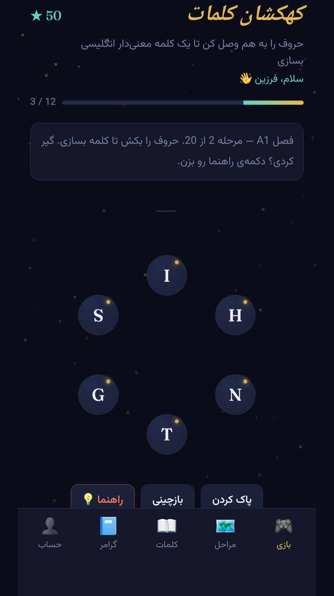
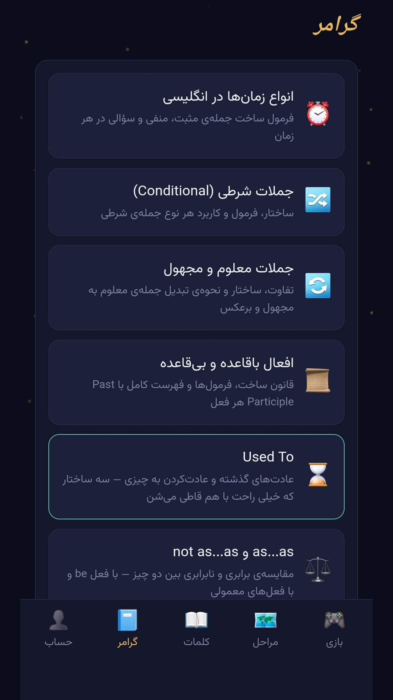
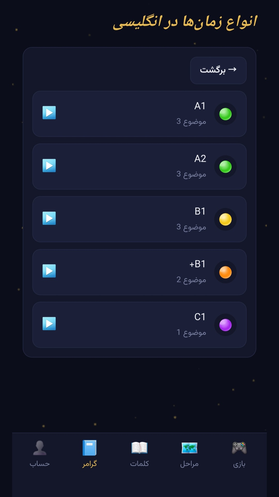
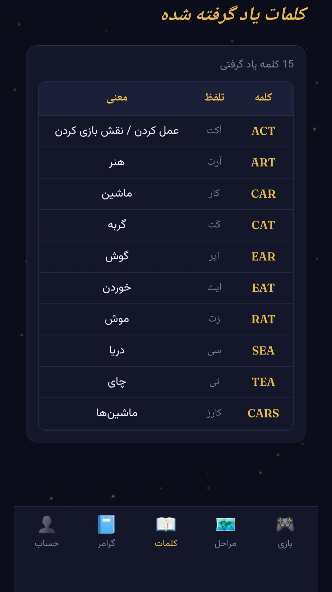
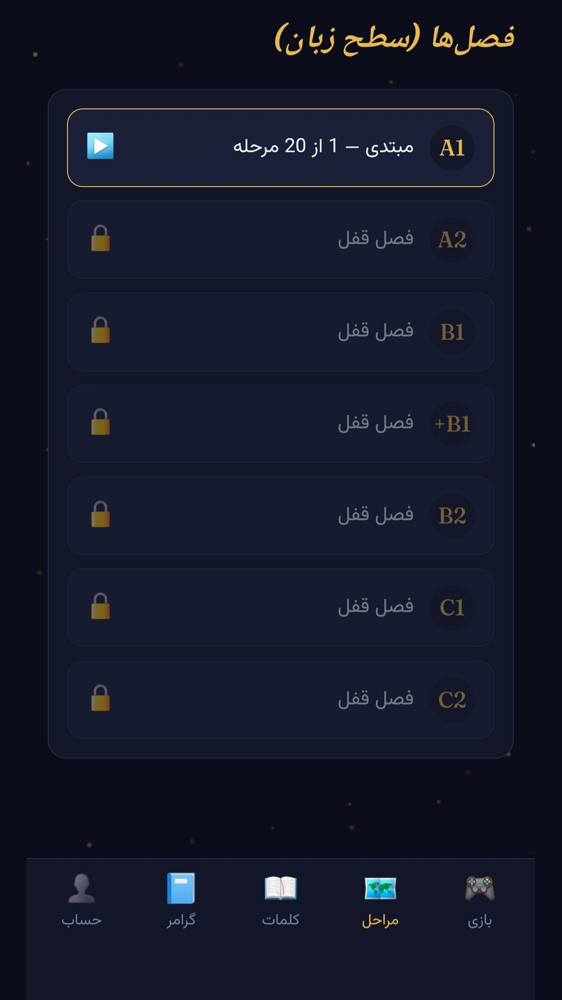

# Manabe Zaban | منابع زبان

**Manabe Zaban** is an Android application designed to support English learners with learning resources, vocabulary tools, grammar materials, and interactive word games.

## Features

- English learning resources
- Vocabulary tools
- Grammar learning materials
- Interactive word games

## Download

- **Android app:** [Download from Myket](https://myket.ir/app/com.farzin.manabezaban)
- **GitHub Release:** [View the latest release and APK](https://github.com/farzinhatammabni/manabe-zaban/releases/latest)

## Development

This project was created with AI assistance using Claude. It is part of my technology portfolio and my ongoing learning journey in software and application development.

## Project Information

- **Platform:** Android
- **App name:** Manabe Zaban (منابع زبان)
- **Distribution:** Myket
- **Repository purpose:** Project documentation and release distribution
  
#### Screenshots

